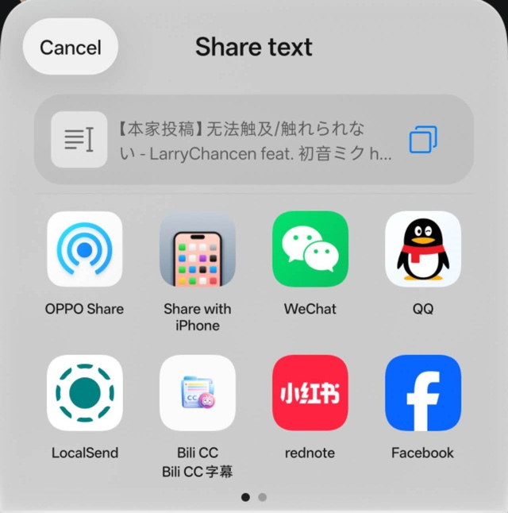
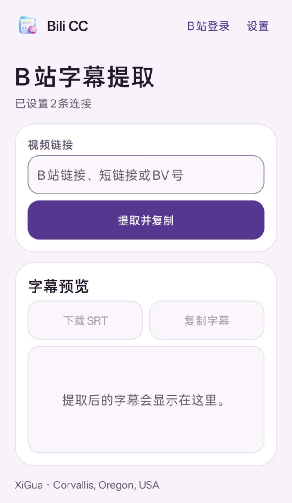
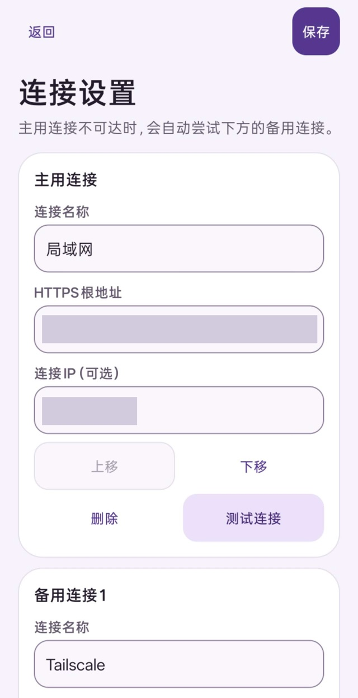

  

<h1 align="center">Bili CC Server</h1>

在 NAS 上跑一套字幕服务，Chrome、Android 和网页都能用。

  <a href="docs/server.md">部署服务</a> ·
  <a href="extension/README.md">Chrome</a> ·
  <a href="android/README.md">Android</a> ·
  <a href="https://github.com/dyxiguajun/bili-cc-extractor#在电脑上运行">在一台电脑上运行</a>

把服务部署在自己的 NAS 或 Linux 主机上，多个客户端可以共用这个地址。平时只在一台电脑上粘贴链接、复制字幕或下载 SRT，可以直接[启动 Bili CC Extractor 本机版](https://github.com/dyxiguajun/bili-cc-extractor#在电脑上运行)。

## 选一个入口

| 入口 | 怎么提取 |
| --- | --- |
| **Chrome** | 打开 B 站视频，点工具栏里的 Bili CC 图标。提取成功后默认复制到剪贴板，可在浮窗里预览和换字幕轨。 |
| **Android** | 在 B 站点「分享 → 更多 → Bili CC 字幕」，直接复制中文字幕。也可以在 App 里手动提取并下载 SRT。[实机演示](#android-实机演示) |
| **网页** | 打开服务地址，粘贴视频链接或 BV 号。适合临时提取或下载 SRT。 |

部分字幕需要登录后才能看到。网页和 Chrome 浮窗可用哔哩哔哩 App 扫码，登录后再选择要提取的字幕轨。

## Android 实机演示

以下是 OPPO（ColorOS）手机上的实际界面。截图已隐藏服务地址、内网 IP 和附近设备信息。

| 从 B 站分享 | 在 App 手动提取 | 设置主用和备用连接 |
| :---: | :---: | :---: |
|  |  |  |

- **从 B 站分享**。在视频页点「分享 → 更多」，再选系统分享面板里的「Bili CC 字幕」。有可提取的中文字幕时，App 会复制到剪贴板，并用系统提示显示「中文字幕已复制」。
- **手动提取**。在首页粘贴 B 站视频链接、短链接或 BV 号，点「提取并复制」。提取后可以在下方预览、再次复制或下载 SRT。遇到需要登录的视频，先点右上角「B 站登录」。
- **连接设置**。在首页点「设置」。图中把「局域网」放在第一条，把「Tailscale」作为备用。逐条点「测试连接」，确认可达后点「保存」。主用不可达时，App 会依序尝试备用连接。

[Android 安装与配置说明](android/README.md)

## 部署到 NAS

按[部署说明](docs/server.md)在 NAS 或 Linux 上启动 Docker Compose，配置 HTTPS 入口。用浏览器打开服务地址，确认网页能提取字幕，再把同一个 HTTPS 根地址填到 Chrome 或 Android。局域网和 Tailscale 可以同时使用，见[局域网配置](ops/lan/README.md)。

开发者可查阅 [Web 与 Android 界面规范](docs/ui.md)。

本仓库代码使用 [MIT 许可](LICENSE)。
